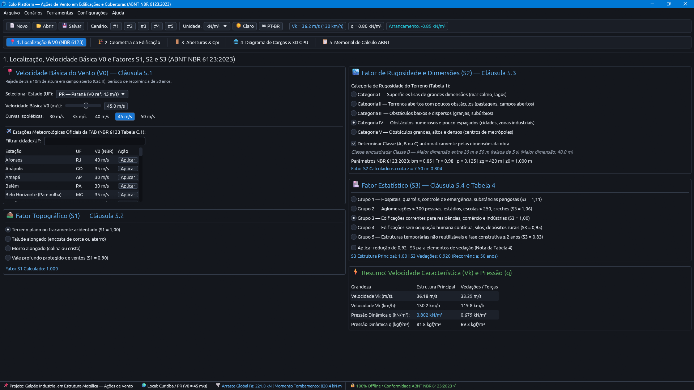
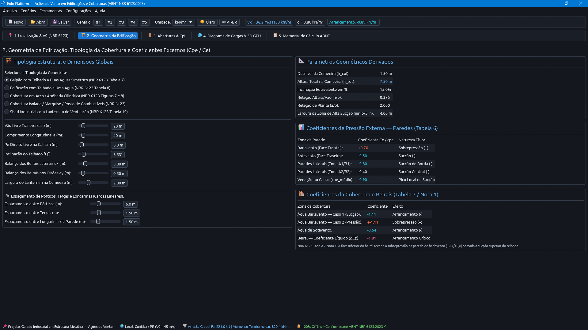
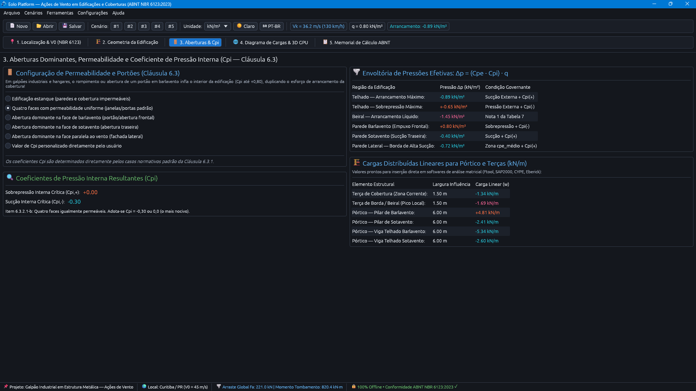
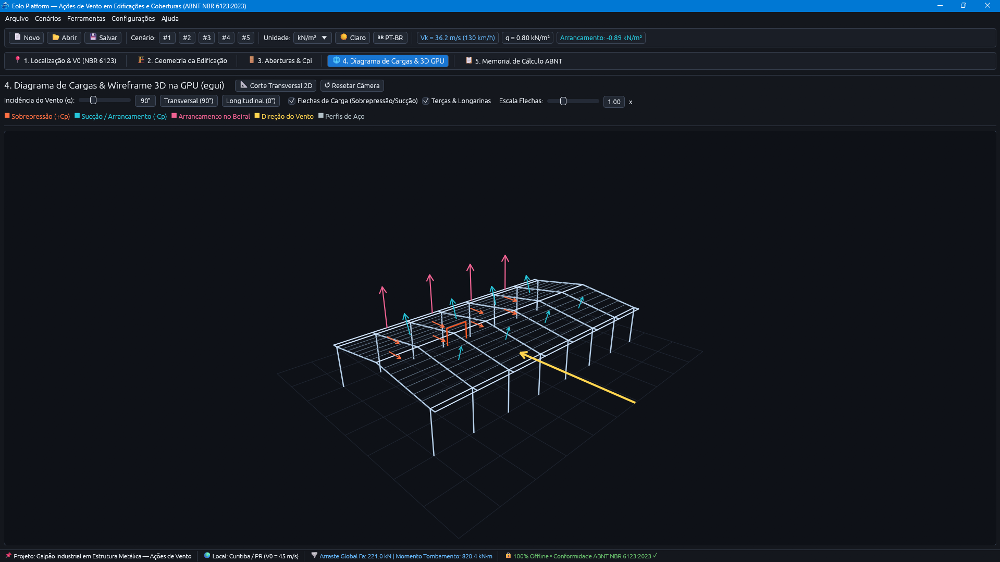
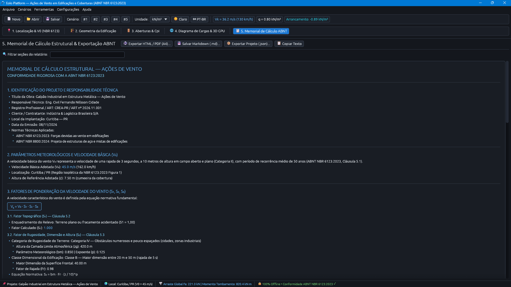
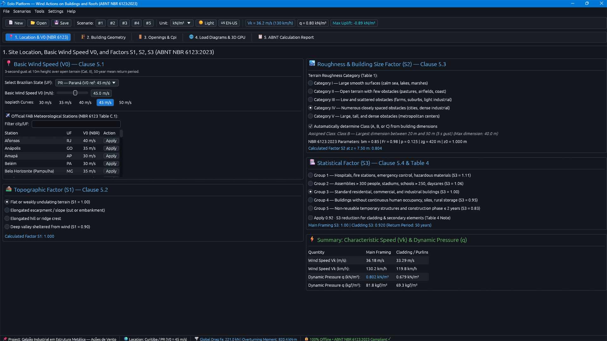
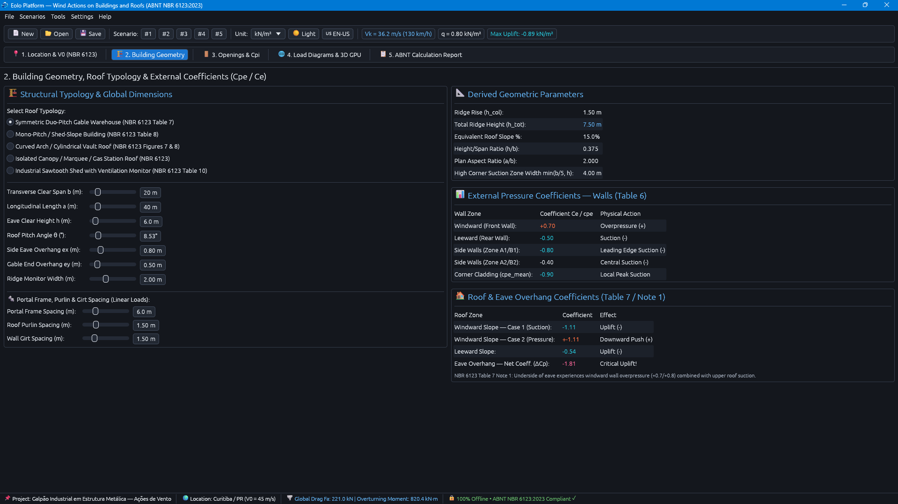
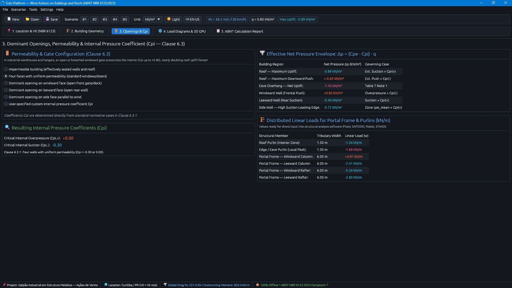
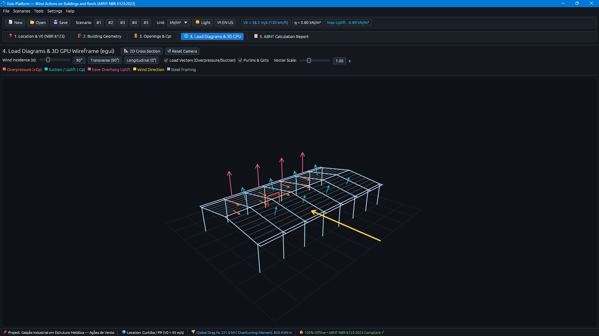
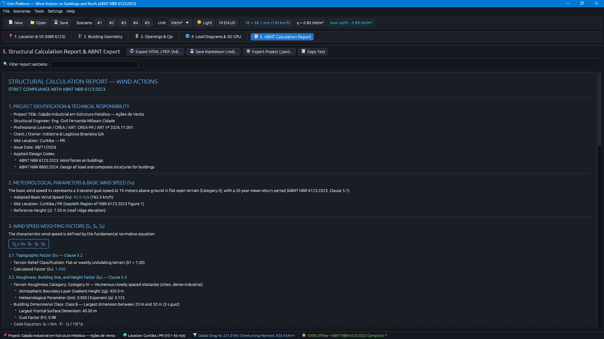

# Eolo Platform — Ações de Vento em Edificações (ABNT NBR 6123:2023)

**Plataforma de alta precisão em engenharia civil e aerodinâmica das construções para modelagem matemática determinística das ações do vento em edificações e estruturas industriais conforme a ABNT NBR 6123:2023. Desenvolvido nativamente em Rust (Edição 2021) com interface gráfica em modo imediato acelerada por GPU em `egui`/`eframe`/`wgpu` e utilitário autônomo de linha de comando (`eolo-cli.exe`).**

[](../../releases/latest)
[](Cargo.toml)
[](Cargo.toml)
[](docs/compliance.md)
[](https://microsoft.com)
[](https://apps.microsoft.com/detail/9NHTCM7PZ9MM)
[](LICENSE)
[](docs/licensing.md)
[](docs/security-model.md)

<p align="center">
  <a href="docs/user-guide.md">📖 Guia do Usuário</a> •
  <a href="docs/architecture.md">🏗️ Arquitetura</a> •
  <a href="docs/compliance.md">📋 Conformidade</a> •
  <a href="docs/security-model.md">🛡️ Segurança</a> •
  <a href="docs/cli-reference.md">💻 CLI</a> •
  <a href="docs/licensing.md">⚖️ Licenciamento</a><br>
  <b>Selecione o idioma / Select language:</b><br>
  <a href="#ptbr">🇧🇷 Português (BR)</a> •
  <a href="#enus">🇺🇸 English (US)</a>
</p>

---

## <a id="ptbr"></a>🇧🇷 Português (BR)

> **Observação:** Este repositório refere-se à versão estável **`2026.11.11.0`** do **Eolo Platform** (implementação nativa em **Rust**). Apoie o projeto e instale a versão oficial assinada digitalmente através da **[Microsoft Store](https://apps.microsoft.com/detail/9NHTCM7PZ9MM)**.

<details>
<summary><b>Clique para expandir / recolher o README em português</b></summary><br>

<p align="center">
  
</p>

<h4 align="center">📸 Galeria de Capturas de Tela Oficiais (Microsoft Store / Interface Desktop)</h4>

| 1. Localização & Isopletas V0 (NBR 6123) | 2. Geometria da Edificação (Cpe / Ce) |
|:---:|:---:|
| [](https://github.com/fernandoncidade/EoloPlatform_rs/blob/main/repo/LISTAGEM/pt_BR/Captura%20de%20tela%202026-11-08%20021625.png?raw=true) | [](https://github.com/fernandoncidade/EoloPlatform_rs/blob/main/repo/LISTAGEM/pt_BR/Captura%20de%20tela%202026-11-08%20021635.png?raw=true) |
| **3. Aberturas de Fachada & Pressão Interna Cpi** | **4. Diagrama de Cargas & Visualizador 3D na GPU** |
| [](https://github.com/fernandoncidade/EoloPlatform_rs/blob/main/repo/LISTAGEM/pt_BR/Captura%20de%20tela%202026-11-08%20021645.png?raw=true) | [](https://github.com/fernandoncidade/EoloPlatform_rs/blob/main/repo/LISTAGEM/pt_BR/Captura%20de%20tela%202026-11-08%20021654.png?raw=true) |
| **5. Memorial de Cálculo Formal ABNT NBR 6123** | **Identidade Visual Oficial (Windows 11)** |
| [](https://github.com/fernandoncidade/EoloPlatform_rs/blob/main/repo/LISTAGEM/pt_BR/Captura%20de%20tela%202026-11-08%20021705.png?raw=true) | [](https://github.com/fernandoncidade/EoloPlatform_rs/blob/main/repo/LISTAGEM/pt_BR/eolo_identidade_visual_1919-1079.png?raw=true) |

---

### ⚖️ Manifesto e Autorização Legal do Titular dos Direitos Autorais

> **Declaração Expressa de Fernando Nillsson Cidade:**  
> Eu, **Fernando Nillsson Cidade**, na qualidade de único autor, criador original e detentor dos direitos autorais do projeto **Eolo Platform**, **autorizo expressamente o uso, estudo, cópia, modificação, compilação e distribuição do código-fonte deste repositório** estritamente nos termos e condições estabelecidos no arquivo de licença **[LICENSE](LICENSE)** (**GNU Affero General Public License v3 — GNU AGPLv3**).  
> Toda versão modificada ou trabalho derivado deve obrigatoriamente manter os créditos da autoria original e disponibilizar o código-fonte correspondente sob os mesmos termos da licença GNU AGPLv3.  
> As compilações oficiais distribuídas comercialmente através da Microsoft Store ou instaladores assinados são regidas pelo respectivo **EULA Comercial** e **CLC**, assegurando garantias legais ao consumidor e suporte técnico continuado.

---

### 📌 Ficha Técnica do Projeto

- **Nome Oficial:** Eolo Platform
- **Versão:** `2026.11.11.0` (Data: 11 de novembro de 2026)
- **Autor e Engenheiro Responsável:** Fernando Nillsson Cidade
- **E-mail Institucional:** `linceu_lighthouse@outlook.com`
- **Repositório Oficial:** `https://github.com/fernandoncidade`
- **Normas Técnicas Brasileiras:** ABNT NBR 6123:2023, ABNT NBR 8800:2024 e ABNT NBR 6118:2023
- **Executáveis Gerados:**
  - `eolo.exe`: Interface Gráfica Desktop com renderização em GPU (`src/main.rs`)
  - `eolo-cli.exe`: Utilitário autônomo de Linha de Comando para scripts e CI/CD (`src/bin/main_cli.rs`)
- **Identificador Windows (AppUserModelID):** `FernandoCidade.EoloPlatform.NBR6123.2026`

---

### 🌟 Principais Recursos e Diferenciais de Engenharia

1. **Motor Normativo Determinístico da ABNT NBR 6123:2023:**
   - Base integrada de **isopletas de velocidade básica ($V_0$)** cobrindo todas as capitais brasileiras e estações meteorológicas oficiais da Força Aérea Brasileira (FAB);
   - Cálculo analítico contínuo do **Fator Topográfico ($S_1$)** para terreno plano, taludes e morros;
   - Cálculo contínuo do **Fator de Rugosidade, Dimensões e Altura ($S_2$)** para as Categorias I a V e Classes A, B e C;
   - Avaliação do **Fator Estatístico ($S_3$)** em função dos grupos de ocupação e risco da edificação;
   - Determinação instantânea da **Velocidade Característica ($V_k$)** e da **Pressão Dinâmica Básica ($q = 0,613 \cdot V_k^2$)**;
   - Coeficientes de forma e pressão externa ($C_{pe}$) para paredes sob ventos a 0° e 90°, coberturas de uma água, duas águas com inclinação contínua $\alpha$, sheds, coberturas curvas e marquises;
   - Coeficientes de pressão interna ($C_{pi}$) por permeabilidade e aberturas dominantes;
   - Cálculo de forças globais de arrasto, cortante de base ($F_x, F_y$) e momentos de tombamento ($M_{x}, M_{y}$).
2. **Ambiente Gráfico Estruturado em 5 Abas de Trabalho:**
   - **Aba 1 (Localização):** Definição regional, consulta de isopletas e parametrização de $S_1, S_2, S_3$;
   - **Aba 2 (Geometria):** Dimensões volumétricas tridimensionais, seleção do tipo de telhado e ângulos de vertente;
   - **Aba 3 (Aberturas):** Configuração de porosidade das fachadas e identificação de aberturas dominantes;
   - **Aba 4 (3D Canvas):** Visualizador tridimensional interativo na GPU com órbita, pan, zoom e setas direcionadas de pressão e sucção;
   - **Aba 5 (Memorial):** Emissão em tempo real do Memorial de Cálculo técnico auditável com fórmulas e valores substituídos.
3. **Privacidade Soberana e Filosofia 100% Local-First:**
   - Zero tráfego de rede, zero telemetria, zero cookies e nenhum envio de projetos para servidores remotos;
   - Inexistência de modelos de linguagem (LLMs) em nuvem na pipeline de cálculo, garantindo reprodutibilidade matemática pura.
4. **Exportação Técnica Multiformato:**
   - Geração de laudos estruturais em **HTML5** estilizado (pronto para PDF via impressão do navegador), **Markdown (`.md`)** e **JSON estruturado**.
5. **Integração Visual Nativa com o Windows 11:**
   - Ícone multi-resolução embutido no PE executável via `winres`;
   - Fixação estável na Barra de Tarefas e no Menu Iniciar vinculada ao `AppUserModelID`.

---

### 🚀 Compilação e Execução a partir do Código-Fonte

#### Pré-requisitos
- Toolchain estável de **Rust 1.80+** (Edição 2021) instalada via `rustup`;
- Ambiente Windows 10/11 x64 com compilador C/C++ (MSVC / Build Tools for Visual Studio).

#### Comandos de Compilação
```powershell
# Clonar o repositório oficial
git clone https://github.com/fernandoncidade/EoloPlatform_rs.git
cd EoloPlatform_rs

# Executar a esteira de testes automatizados
cargo test

# Compilar ambos os binários em modo de release otimizado
cargo build --release --bin eolo --bin eolo-cli

# Os executáveis finais são gerados em:
# builds\eolo\release\eolo.exe
# builds\eolo\release\eolo-cli.exe
```

---

### 💻 Execução via Linha de Comando (`eolo-cli.exe`)

```powershell
# Cálculo expedito de Vk e pressão dinâmica q
.\builds\eolo\release\eolo-cli.exe calc --v0 45.0 --cat 4 --class b --s3 1.0 -z 15.0

# Geração de memorial técnico a partir do Cenário 1 (Galpão Industrial)
.\builds\eolo\release\eolo-cli.exe report --scenario 1 --format html --output memorial.html

# Consulta de estações meteorológicas e isopletas do Paraná (PR)
.\builds\eolo\release\eolo-cli.exe isopleth --uf PR

# Auditoria e validação normativa automática
.\builds\eolo\release\eolo-cli.exe verify --scenario 1
```

---

### 🏛️ Finalidade Exclusivamente Acadêmica, Risco de Erros & Responsabilidade Técnica

> **⚠️ AVISO IMPORTANTE (ESTUDO ACADÊMICO APENAS):**  
> O **Eolo Platform** é uma aplicação desenvolvida **exclusivamente para fins de estudos acadêmicos, aprendizado e pesquisa educacional**, tomando como referência bibliográfica a **ABNT NBR 6123:2023** (sem reprodução de conteúdo normativo protegido da ABNT; referências bibliográficas disponíveis em `Ajuda > Sobre o Eolo Platform... > Avisos`).  
> O software **pode conter erros de cálculo ou programação** e **NÃO serve como software definitivo para tomadas de decisão em produção, projetos executivos, obras civis ou ambientes de trabalho**. Todos os resultados **devem ser obrigatoriamente conferidos manualmente** (a partir de exemplar oficial da norma) ou por meio de **ferramentas mais consolidadas no mercado**, sempre sob responsabilidade e recolhimento de **ART** por Engenheiro legalmente habilitado (CREA/CONFEA — Leis nº 5.194/1966 e nº 6.496/1977), eximindo-se o autor de responsabilidade legal por uso real ou produtivo (Código Civil arts. 186, 393 e 927; CDC arts. 6º, III, 14 §3º II e 31, preservados os direitos irrenunciáveis do consumidor; convenções internacionais `"AS IS"` / `"WITH ALL FAULTS"`).

---

### ⚖️ Duplo Licenciamento e Garantias Legais

- **Código-Fonte (GitHub):** Licenciado sob **GNU Affero General Public License v3 (GNU AGPLv3)**;
- **Edição Comercial (Microsoft Store):** Licenciada sob o **Contrato de Licença de Usuário Final (EULA)** e **Condições de Licença Comercial (CLC)**;
- **Validade Técnica (Lei nº 9.609/1998, Art. 7º):** 12 (doze) meses a partir de 8 de novembro de 2026;
- **Suporte Técnico (Lei nº 9.609/1998, Art. 8º):** Suporte e correções corretivas via `linceu_lighthouse@outlook.com`;
- **Direito de Desistência (CDC, Art. 49):** Prazo de arrependimento de 7 dias para compras digitais na Microsoft Store.

</details>

---

## <a id="enus"></a>🇺🇸 English (US)

> **Note:** This repository corresponds to stable release **`2026.11.11.0`** of **Eolo Platform** (native **Rust** implementation). Support the project and install the official digitally signed edition via the **[Microsoft Store](https://apps.microsoft.com/detail/9NHTCM7PZ9MM)**.

<details>
<summary><b>Click to expand / collapse the README in English</b></summary><br>

<p align="center">
  
</p>

<h4 align="center">📸 Official Screenshot Gallery (Microsoft Store / Desktop Interface)</h4>

| 1. Location & Basic Wind Speed V0 (NBR 6123) | 2. Building Geometry (Cpe / Ce Coefficients) |
|:---:|:---:|
| [](https://github.com/fernandoncidade/EoloPlatform_rs/blob/main/repo/LISTAGEM/en_US/Captura%20de%20tela%202026-11-08%20021719.png?raw=true) | [](https://github.com/fernandoncidade/EoloPlatform_rs/blob/main/repo/LISTAGEM/en_US/Captura%20de%20tela%202026-11-08%20021729.png?raw=true) |
| **3. Facade Openings & Internal Pressure Cpi** | **4. Load Diagrams & 3D Viewport on GPU** |
| [](https://github.com/fernandoncidade/EoloPlatform_rs/blob/main/repo/LISTAGEM/en_US/Captura%20de%20tela%202026-11-08%20021741.png?raw=true) | [](https://github.com/fernandoncidade/EoloPlatform_rs/blob/main/repo/LISTAGEM/en_US/Captura%20de%20tela%202026-11-08%20021753.png?raw=true) |
| **5. Formal ABNT NBR 6123 Calculation Report** | **Official Visual Identity (Windows 11)** |
| [](https://github.com/fernandoncidade/EoloPlatform_rs/blob/main/repo/LISTAGEM/en_US/Captura%20de%20tela%202026-11-08%20021804.png?raw=true) | [](https://github.com/fernandoncidade/EoloPlatform_rs/blob/main/repo/LISTAGEM/en_US/eolo_visual_identity_1919-1079.png?raw=true) |

---

### ⚖️ Copyright Holder Manifesto & Legal Authorization

> **Express Declaration of Fernando Nillsson Cidade:**  
> I, **Fernando Nillsson Cidade**, as the sole author, original creator, and copyright holder of the **Eolo Platform** project, **expressly authorize the use, study, copying, modification, compilation, and distribution of the source code in this repository** strictly under the terms and conditions set forth in the **[LICENSE](LICENSE)** file (**GNU Affero General Public License v3 — GNU AGPLv3**).  
> Any modified version or derivative work must preserve original authorship attribution and release the corresponding source code under the identical terms of the GNU AGPLv3.  
> Official commercial builds distributed through the Microsoft Store or signed standalone installers are governed by their respective **Commercial EULA** and **CLC**, ensuring statutory consumer warranties and continuous technical support.

---

### 📌 Project Fact Sheet

- **Official Name:** Eolo Platform
- **Version:** `2026.11.11.0` (Date: November 11, 2026)
- **Author & Structural Engineer:** Fernando Nillsson Cidade
- **Institutional Contact:** `linceu_lighthouse@outlook.com`
- **Official Repository:** `https://github.com/fernandoncidade`
- **Governing Engineering Codes:** ABNT NBR 6123:2023, ABNT NBR 8800:2024, and ABNT NBR 6118:2023
- **Generated Binaries:**
  - `eolo.exe`: Desktop Graphical User Interface with GPU rendering (`src/main.rs`)
  - `eolo-cli.exe`: Standalone Command-Line Interface for scripting and CI/CD (`src/bin/main_cli.rs`)
- **Windows Shell AppUserModelID:** `FernandoCidade.EoloPlatform.NBR6123.2026`

---

### 🌟 Key Capabilities & Engineering Distinctions

1. **Deterministic ABNT NBR 6123:2023 Normative Engine:**
   - Integrated **basic wind velocity ($V_0$) isopleth database** covering all Brazilian state capitals and Air Force (FAB) meteorological stations;
   - Continuous analytical evaluation of **Topographic Factor ($S_1$)** for flat terrain, slopes, and ridges;
   - Continuous analytical evaluation of **Roughness, Dimensions, and Height Factor ($S_2$)** across Categories I–V and Classes A–C;
   - Computation of **Statistical Factor ($S_3$)** based on building occupancy and risk categories;
   - Instantaneous computation of **Characteristic Wind Speed ($V_k$)** and **Dynamic Stagnation Pressure ($q = 0.613 \cdot V_k^2$)**;
   - External aerodynamic pressure coefficients ($C_{pe}$) for walls at 0° and 90°, monopitch roofs, gable roofs with continuous pitch angle $\alpha$, sawtooth sheds, curved roofs, and canopies;
   - Internal pressure coefficients ($C_{pi}$) modeling envelope porosity and dominant openings;
   - Global drag forces, base shear ($F_x, F_y$), and overturning moments ($M_x, M_y$).
2. **Structured 5-Tab Engineering Interface:**
   - **Tab 1 (Location):** Regional setup, isopleth lookup, and $S_1, S_2, S_3$ factor configuration;
   - **Tab 2 (Geometry):** 3D volumetric dimensions, roof typologies, and pitch angles;
   - **Tab 3 (Openings):** Facade opening areas, porosity ratios, and dominant openings;
   - **Tab 4 (3D Canvas):** Interactive 3D GPU viewport supporting orbit, pan, zoom, and directed pressure vectors;
   - **Tab 5 (Memorial):** Real-time generation of auditable technical calculation books with substituted formulas.
3. **Sovereign Privacy & 100% Local-First Architecture:**
   - Zero network communication, zero telemetry, zero cookies, and zero project uploads to external clouds;
   - Complete exclusion of cloud LLMs from the analytical pipeline, guaranteeing strict arithmetic reproducibility.
4. **Multi-Format Technical Reporting:**
   - Produces formal engineering reports in styled **HTML5** (print-ready for PDF generation), **Markdown (`.md`)**, and structured **JSON**.
5. **Native Windows 11 Shell Integration:**
   - Multi-resolution icon compiled directly into the PE header via `winres`;
   - Robust Taskbar grouping and Start Menu shortcut persistence via dedicated `AppUserModelID`.

---

### 🚀 Building and Running from Source

#### Prerequisites
- Stable **Rust 1.80+** (Edition 2021) installed via `rustup`;
- Windows 10/11 x64 environment with MSVC C/C++ build tools.

#### Build Commands
```powershell
# Clone official repository
git clone https://github.com/fernandoncidade/EoloPlatform_rs.git
cd EoloPlatform_rs

# Run analytical automated test suite
cargo test

# Compile both binaries in optimized release mode
cargo build --release --bin eolo --bin eolo-cli

# Output executables are created at:
# builds\eolo\release\eolo.exe
# builds\eolo\release\eolo-cli.exe
```

---

### 💻 Command-Line Interface (`eolo-cli.exe`)

```powershell
# Rapid calculation of Vk and dynamic pressure q
.\builds\eolo\release\eolo-cli.exe calc --v0 45.0 --cat 4 --class b --s3 1.0 -z 15.0

# Generate calculation book from Preset Scenario 1 (Industrial Warehouse)
.\builds\eolo\release\eolo-cli.exe report --scenario 1 --format html --output memorial.html

# Query meteorological stations and isopleths for Paraná (PR)
.\builds\eolo\release\eolo-cli.exe isopleth --uf PR

# Automated normative compliance audit
.\builds\eolo\release\eolo-cli.exe verify --scenario 1
```

---

### 🏛️ Exclusively Academic Purpose, Risk of Errors & Engineering Responsibility Notice

> **⚠️ IMPORTANT NOTICE (ACADEMIC STUDY ONLY):**  
> **Eolo Platform** is an application developed **exclusively for academic study, learning, and educational research**, using **ABNT NBR 6123:2023** solely as a bibliographic reference (with no reproduction of copyrighted ABNT standard text; full bibliographic references are listed in `Help > About Eolo Platform... > Notices`).  
> The software **may contain programming or calculation errors** and **does NOT serve as definitive software for decision-making in production, structural construction, or workplace environments**. All results **MUST be verified manually** (against an officially acquired standard copy) or cross-checked with **consolidated, industry-validated market tools**, under the supervision and **ART** registration of a licensed engineer (CREA/CONFEA — Brazilian Laws No. 5,194/1966 & No. 6,496/1977), exempting the author from legal liability for real-world production use (Brazilian Civil Code Arts. 186, 393 & 927; CDC Arts. 6(III), 14(§3)(II) & 31, preserving non-waivable consumer rights; international `"AS IS"` / `"WITH ALL FAULTS"` conventions).

---

### ⚖️ Dual-Licensing & Statutory Warranties

- **Source Code (GitHub):** Licensed under **GNU Affero General Public License v3 (GNU AGPLv3)**;
- **Commercial Edition (Microsoft Store):** Governed by the **Commercial End User License Agreement (EULA)** and **Commercial License Conditions (CLC)**;
- **Technical Validity Warranty (Brazilian Law 9,609/1998, Art. 7):** 12 months starting November 8, 2026;
- **Technical Support (Brazilian Law 9,609/1998, Art. 8):** Dedicated support via `linceu_lighthouse@outlook.com`;
- **Right of Withdrawal (Brazilian CDC, Art. 49):** 7-day refund window for digital purchases via the Microsoft Store.

</details>
